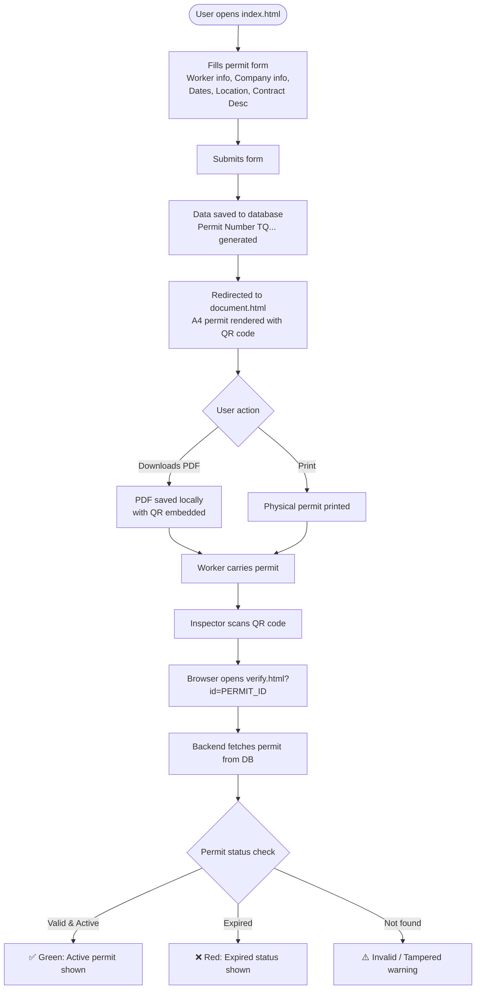

# Ajeer Work Permit System — Business Requirements & Technical Plan

---

## 1. Business Overview

**Ajeer (أجير)** is a Saudi Ministry of Human Resources platform that manages **temporary labor work permits** for contract workers. This prototype simulates the permit issuance and verification workflow used by recruitment companies, beneficiary establishments, and labor inspectors.

---

## 2. User Roles

| Role | Who | What They Do |
|---|---|---|
| **Permit Issuer** | Recruitment Company (شركة الإستقدام) | Fills the form, generates the permit, downloads the PDF |
| **Worker** | Employee/Laborer | Carries the physical/printed permit document |
| **Inspector / Verifier** | Ministry official, police, site supervisor | Scans the QR code to verify permit validity |

---

## 3. Complete User Journey (Flow)



---

## 4. The Core Problem — Data Persistence

### Current Prototype Limitation
The current prototype uses **`localStorage`** to store permit data. This has a critical flaw:

> [!CAUTION]
> `localStorage` is **browser-local and device-specific**. When a QR code is scanned on **a different device or browser**, the data will NOT be found. The verification page will fall back to dummy default data — making the QR completely meaningless in a real scenario.

### What We Need
A **server-side database** where:
- Permits are stored on submission (POST)
- Any device scanning the QR can retrieve the permit (GET by ID)
- The permit status (active/expired) is computed server-side

---

## 5. Data Model — Permit Record

```
┌─────────────────────────────────────────────────────────┐
│                      permits table                       │
├──────────────────────┬──────────────────────────────────┤
│ Field                │ Description                      │
├──────────────────────┼──────────────────────────────────┤
│ id (PK)              │ Auto-increment integer            │
│ permit_number        │ TQ-style string (e.g. TQ4847073) │
│ laborer_name         │ Full name of the worker           │
│ occupation           │ Job title / profession            │
│ id_number            │ Iqama / national ID (indexed)     │
│ nationality          │ Worker's nationality              │
│ provider_name        │ Recruitment company name          │
│ provider_num         │ Est. number (e.g. 2-2-681349)    │
│ beneficiary_name     │ Beneficiary establishment name    │
│ beneficiary_num      │ Beneficiary est. number           │
│ contract_desc        │ نبذة عن التعاقد                   │
│ start_date           │ Permit validity start (DATE)      │
│ end_date             │ Permit validity end (DATE)        │
│ work_location        │ City / site of work               │
│ created_at           │ Record creation timestamp         │
│ status               │ ENUM: active / expired / revoked  │
└──────────────────────┴──────────────────────────────────┘
```

---

## 6. Required API Endpoints

| Method | Route | Description |
|---|---|---|
| `POST` | `/api/permits` | Submit form → save permit → return `permit_number` |
| `GET` | `/api/permits/:id_number` | QR scan → fetch permit data by Iqama ID |
| `GET` | `/api/permits/by-permit/:permit_number` | Fetch by TQ number |
| `GET` | `/api/health` | Health check |
| *(Optional)* `GET` | `/api/permits` | Admin list all permits |
| *(Optional)* `DELETE` | `/api/permits/:id` | Revoke a permit |

---

## 7. Technology Comparison

### Option A — **Node.js + Express + SQLite** ✅ Recommended
> Best fit for this prototype → production-grade later

| Pros | Cons |
|---|---|
| Fast to set up (< 1 hour) | Not Django/Python ecosystem |
| SQLite = zero config DB (single file) | Single-process (fine for prototype) |
| Same language as frontend (JS) | Need to swap to PostgreSQL for scale |
| Easy to add PDF generation (`puppeteer`) | |
| Minimal dependencies | |

**Stack:** `express` + `better-sqlite3` + `cors` + `puppeteer` (PDF)

---

### Option B — **Django + SQLite**
> Good if Python is preferred

| Pros | Cons |
|---|---|
| Built-in ORM, admin panel | Heavier setup (virtualenv, migrations) |
| Django REST Framework for APIs | Slower iteration for small apps |
| Python PDF libs (`weasyprint`) | Template + JS mismatch (different paradigm) |
| Production-ready from day 1 | Overkill for this size |

---

### Option C — **Next.js (Full-Stack)**
> Good if React frontend is planned

| Pros | Cons |
|---|---|
| API Routes built-in | Requires rewriting frontend in React |
| Single codebase | More complex for pure HTML prototype |
| Vercel deployment trivial | |

---

### Option D — **Firebase / Supabase (BaaS)**
> Good for zero backend code

| Pros | Cons |
|---|---|
| No server code needed | Requires internet always |
| Real-time sync | Data leaves your infrastructure |
| Free tier available | Privacy/GDPR concerns for labor data |

---

## 8. Recommended Architecture — Node.js + Express + SQLite

```
ajeer-backend/
├── server.js              ← Express app entry point
├── db.js                  ← SQLite init + schema
├── routes/
│   └── permits.js         ← /api/permits routes
├── public/                ← Static HTML files (index, document, verify)
│   ├── index.html
│   ├── document.html
│   └── verify.html
├── package.json
└── permits.db             ← SQLite database file (auto-created)
```

### How it works end-to-end:
1. **Express serves** `index.html`, `document.html`, `verify.html` as static files
2. **Form submit** → `POST /api/permits` → saved in SQLite → returns `permit_number`
3. **document.html** → fetches `GET /api/permits/:id_number` to populate fields + QR
4. **verify.html** → same API call when QR is scanned from any device
5. **PDF** → either `window.print()` or a `/api/permits/:id/pdf` endpoint via Puppeteer

---

## 9. Permit Number Generation Strategy

```
Format: TQ + [7 digit number]
Example: TQ4847073

Generation: Sequential counter from DB (auto-increment)
or: "TQ" + zero-padded(permit.id * 97 + salt)
```

The `permit_number` is what gets embedded in the QR code URL:
```
https://yourdomain.com/verify.html?id=TQ4847073
```

---

## 10. Implementation Phases

### Phase 1 — Backend Foundation (Node.js)
- [ ] `npm init` + install express, better-sqlite3, cors
- [ ] Create `db.js` with schema and auto-migration
- [ ] Create `POST /api/permits` route
- [ ] Create `GET /api/permits/:id_number` route
- [ ] Serve static HTML files via Express

### Phase 2 — Frontend Integration
- [ ] Update `index.html` form submit → `fetch('/api/permits', {method:'POST',...})`
- [ ] Update `document.html` → `fetch('/api/permits/:id')` instead of localStorage
- [ ] Update `verify.html` → same API fetch

### Phase 3 — PDF Download
- [ ] Add "Download PDF" button to document.html
- [ ] Either use browser `window.print()` → Save as PDF
- [ ] Or add Puppeteer endpoint `GET /api/permits/:id/pdf`

### Phase 4 — Production (Optional)
- [ ] Swap SQLite → PostgreSQL
- [ ] Add authentication for permit issuers
- [ ] Add permit revocation / admin dashboard
- [ ] Deploy to VPS or cloud (DigitalOcean, AWS, etc.)

---

## 11. Key Decision

> [!IMPORTANT]
> **Recommendation: Node.js + Express + SQLite**
>
> Reasons:
> - You already have the frontend in plain HTML/JS → easiest integration
> - SQLite runs as a single `.db` file, zero install, zero config
> - Can be upgraded to PostgreSQL later with minimal code change
> - PDF generation with Puppeteer is trivial in Node
> - Entire backend can be running in **< 2 hours**

---

*Document prepared: October 2026 | Ajeer Permit Prototype — Backend Planning*
